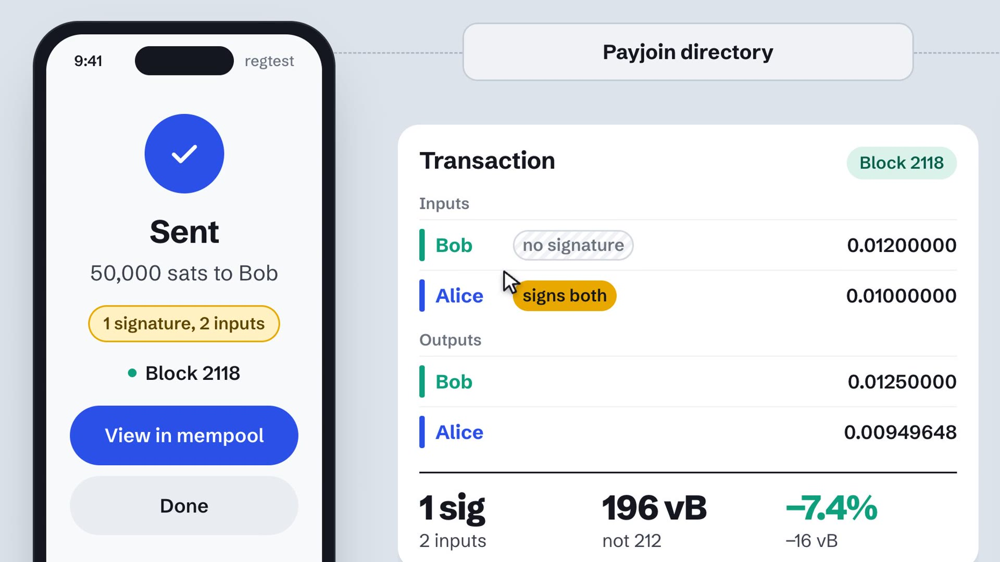

# PISA demo wallets

Two wallets in a browser, Alice and Bob, making a payjoin whose inputs share
one BIP 460 signature, and a mempool explorer showing the result. Everything
runs on a local regtest chain.



The wallets are a thin web UI over the pieces that already work:

- **Signing** is Bitcoin Core from the `bip460` branch (PR #36122): `cisa()`
  descriptors, `reservecisanonce`, and `walletprocesspsbt` for the partial
  signatures and the aggregate.
- **The payjoin** is BIP 77 through the `cisa-psbt-carriage` branch of
  bitcoin-pisa/rust-payjoin, with the payjoin directory and OHTTP relay
  running in-process.
- **Which inputs join the group** is pisa's `declare_fullagg` for Alice and
  `input_pair` for Bob, used as a library.
- **The explorer** is the `cisa-witness-v2` branch of bitcoin-pisa/mempool.

Alice and Bob each run as their own task and talk only through the
directory, as two phones would. The server hosts both and narrates each step
to the page as it happens.

## Run it

The demo expects two other checkouts next to it, in a folder called `src`:

```
pisa/
  demo/            this repository
  src/bitcoin/     bitcoin-pisa/bitcoin, branch bip460, built
  src/mempool/     bitcoin-pisa/mempool, branch cisa-witness-v2, built
```

`SRC`, `BITCOIND_EXE`, `MEMPOOL` and `NODE_BIN` point `scripts/demo.sh`
elsewhere. pisa and the payjoin crates come in through Cargo, pinned to
commits of bitcoin-pisa/pisa and bitcoin-pisa/rust-payjoin.

**Bitcoin Core with BIP 460.** The `bip460` branch is the code of
bitcoin/bitcoin#36122, including the libsecp256k1 half and full
aggregation modules. Release builds treat witness version 2 as anyone can
spend and cannot take part.

```sh
git clone -b bip460 https://github.com/bitcoin-pisa/bitcoin src/bitcoin
cmake -S src/bitcoin -B src/bitcoin/build -DBUILD_TESTS=OFF -DBUILD_GUI=OFF \
  -DENABLE_IPC=OFF -DCMAKE_BUILD_TYPE=Release
cmake --build src/bitcoin/build -j --target bitcoind bitcoin-cli
```

**The explorer.** mempool pins Node 24.13; its backend also builds a Rust
module, which pins Rust 1.84.

```sh
git clone -b cisa-witness-v2 https://github.com/bitcoin-pisa/mempool src/mempool
(cd src/mempool/backend && npm ci && npm run build)
(cd src/mempool/frontend && npm install)
```

If Node 24.13 is not the `node` on your PATH, set `NODE_BIN` to the `bin`
folder of one; by default the script looks in `../tools/`.

**The wallets** need Rust 1.85 or later; `scripts/demo.sh` builds them.

```sh
scripts/demo.sh start --fresh   # new chain, wallets funded; about a minute
scripts/demo.sh stop
scripts/demo.sh status
scripts/demo.sh logs wallets    # or mempool-api, mempool-web
```

Then open:

- wallets: <http://localhost:3000>
- explorer: <http://localhost:4200>

`start` without `--fresh` keeps the chain and the wallets' coins. A fresh
chain starts with 2116 blocks, ten minutes apart, ending now, so that the
explorer's block times and ETAs read like a real chain's.

## The video

`docs/pisa-demo.mp4` is one take, 117 seconds at 1920×1080, recorded on this
laptop with:

```sh
scripts/demo.sh restart --fresh
node scripts/record.mjs [out.mp4]
```

It needs Node 22 or later, ffmpeg on the PATH, and Chrome; `CHROME` names
the Chrome binary if it is not at the macOS default.

`record.mjs` plays the take in a headless Chrome with a throwaway profile,
so nothing else on the screen ends up in it, and a drawn cursor moves to
each button before it is pressed. It is made to be watched on a phone:

- The page is 1280×720 CSS pixels captured at twice that, and in the
  wallet part a camera that follows the action is applied afterwards with
  ffmpeg's `zoompan`: Bob's phone, then Alice's, the transaction while the
  PSBT travels, and close on the card when the two partial signatures
  become one. Close ups are crops of the larger frames, so they stay sharp.
  Short captions at the foot of the frame, or its top where the foot holds
  what they describe, say what happens at each step; the steps they
  describe linger long enough to read them. The phones show one status
  line each, the way a wallet would, and leave the protocol to the lane.
- Every change is eased: camera moves, the scrolling, the spotlight and
  its caption, which glide from one piece to the next, and the move to the
  explorer, where the camera
  first pulls back to the whole stage and the page dips to dark and comes
  up on the explorer at the same framing.
- The explorer part holds one framing while the page scrolls under it. A
  spotlight and a short caption, drawn by the recorder and not part of the
  explorer, go over each piece in turn: the savings, the input without a
  signature, the one that carries it, the same two in the inputs list, the
  payjoin calculations with what Bob received, and the totals.
- It opens on a card that says in three lines what is about to happen,
  `scripts/cards/intro.html`, and ends on one with thanks, the Cypher Tank
  logo, and pisa.payjoin.org, `scripts/cards/endcard.html`.

The wallets link to the explorer with the payjoin ownership fragment,
`/tx/<txid>?showDetails=true#pj=1:rs:rs:Alice:Bob`: one code per input and
output, `s` for the sender and `r` for the recipient, then the two names.
The wallet server builds it from who owns what (`pj_fragment` in
`src/flow.rs`).

## Recording a take by hand

A browser window at 1280×720 shows everything large enough for a phone
screen; at full screen on a larger display the lane grows with the phones.

1. **Bob requests.** *Receive*, keep 50,000 sats, *Create request*.
   His phone shows the QR code and waits on the directory.
2. **Alice scans.** *Send*, *Scan*. The review screen shows the amount and
   *Attempting payjoin*.
3. **Alice sends.** *Send*. Then just watch, about 15 seconds:
   - Alice signs a fallback, reserves a nonce, and her PSBT flies to the
     directory and on to Bob. The lane shows her input with its *fallback
     signature* and the gold nonce.
   - Bob checks it, adds a coin with his nonce, signs his part, and sends the
     proposal back. Alice's fallback signature drops off, Bob's input appears
     with a partial signature, and his output grows by his coin.
   - Alice completes the signature. The two partial signatures fly onto one
     input, which ends up carrying the signature for both; the other has
     none. The stats show 196 vB against 212 vB, 7.4% less.
   - The transaction goes to the network, and Bob's phone says received.
4. **The explorer.** *View in mempool* on Alice's phone opens the transaction
   with its inputs expanded and labelled Alice and Bob. *Signature
   Aggregation* shows 1 / 2 signatures, 16 vB and 28 sats saved, and which
   input has no signature; the inputs list shows the same in the witnesses
   (*aggregated* `<empty>`, *aggregate signature*); *Payjoin* says what Bob
   received.
5. **Confirm.** *Mine a block* (or press `m`). Both phones and the lane say
   confirmed, and so does the explorer.

Between takes, *Reset* (or `Shift+R`) clears both phones and the lane. The
coins stay; Bob gets his coin back with the payment on top every time, so
he never runs dry, and Alice has enough for about 60 takes. `--fresh` starts
over.

Knobs:

- `PACE_MS=1500 scripts/demo.sh start` slows each step down (default 1100).
- `LINGER` at the top of `static/app.js` sets how long the end of a payment
  lingers: the merge into one signature, the finished transaction, the
  flight to the network, and the moments before each phone says done.
- Bob's amount is editable on his phone; the presets are 25k, 50k and 100k.

## Layout

```
src/chain.rs    the regtest node on fixed ports, and the CISA wallets
src/flow.rs     Bob's receiver session and Alice's sender session, step by step
src/events.rs   the narration the page renders
src/main.rs     the HTTP API: state, event stream, request, pay, mine, reset
static/         the page: plain HTML, CSS and JS, no build step
config/         mempool backend and frontend config for this regtest node
scripts/demo.sh starts and stops all three processes
scripts/record.mjs records a take to docs/pisa-demo.mp4
```

The node listens on RPC port 18443 with user and password `pisa`, P2P port
18444, and keeps its datadir in `.data/bitcoin`.

## Caveats

- Regtest only, test keys only. Each fresh chain makes new random keys for
  Alice and Bob.
- The mempool explorer runs without a database, so its dashboard's
  statistics panels stay empty. The block and transaction pages are complete.
- Local changes to the mempool fork, not committed yet:
  - SatoshiPortal's `feat/payjoin-ownership-fragment` (the `#pj=` fragment,
    Sender and Recipient badges on inputs and outputs, a Payjoin box with
    the amount actually received, a Payjoin feature badge), applied to
    `cisa-witness-v2`, and extended with optional names:
    `pj=1:<inputs>:<outputs>[:<sender>[:<recipient>]]`. With names the
    badges say Alice and Bob and the box says "Received by Bob". Its tests
    are in `shared/payjoin-ownership.spec.ts`.
  - A *Signature Aggregation* section on the transaction page
    (`components/cisa-summary/`): three figures, signatures (1 / 2), size
    saved and fee saved, and one row per input showing its signature slot,
    empty or filled, labelled with its owner when the fragment names one.
  - Two rows in *Details*: the weight without aggregation, and the saving.
  - The savings model in `shared/cisa.utils.ts` (`cisaGroups`,
    `cisaSavings`): a member saves its 64-byte signature, the group's final
    input pays one marker byte.
  - The *Taproot* feature badge is hidden for transactions that spend
    witness v2 CISA outputs; it would otherwise suggest the transaction
    could have saved fees by using taproot.
  - The open padlock ("unsigned") that upstream's sighash highlighting
    (6a901342a) puts next to an input without a signature it can parse is
    left off CISA inputs. That parser does not read BIP 460 witnesses and
    marked both inputs unsigned, the aggregate one too.
